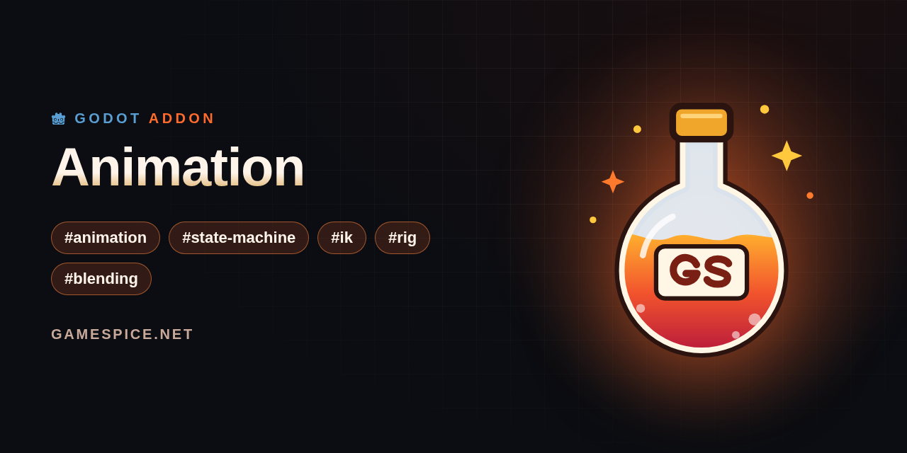

[](https://moddingcommunity.com/a/148-gs-animation)

Godot 4.7+ addon for animation: state machines declared as data, blend and layer rules, foot and aim IK targets, event notifies and one rig contract shared by players and NPCs. Part of the GameSpice addon family.

## Install

1. Copy `addons/dot_animation/` and `addons/dot_core/` into your project.
2. Enable the addon in *Project > Project Settings > Plugins*.

It needs only GameSpice Core ([dot_core](https://github.com/gamespice-platform/core)).

## Quick start

```gdscript
var cfg := DotAnimationConfig.from_files().value as DotAnimationConfig
var graph := DotAnimationGraph.from_dictionary({
	"initial": "idle",
	"states": {"idle": {"clip": "idle_loop"}, "run": {"clip": "run_loop", "speed": 1.5}},
	"transitions": [
		{"from": "idle", "to": "run", "when": [["speed", ">", 0.5]], "blend": 0.2},
		{"from": "run", "to": "idle", "when": [["speed", "<=", 0.5]]},
	],
}).value as DotAnimationGraph

var machine := DotAnimationMachine.new(graph, cfg)
machine.changed.connect(func(from, to): print(from, " -> ", to))
machine.trigger(&"jump")                             # one-shot, consumed by the first transition that wants it
machine.tick({"speed": velocity.length()}, delta)
var pose := machine.pose()                           # {clip, from_clip, weight, speed, loop}: feed it to your player

var weights := DotAnimationBlend.blend_1d([[0.0, "idle"], [2.0, "walk"], [6.0, "run"]], speed)
var hits := notifies.fire(&"run", prev_time, now_time, looped)   # footstep and other events
```

## Settings

Every number is a field on `DotAnimationConfig`. The values below are defaults, and the ranges are inspector slider limits, not enforced caps. Set the property from code or a config file (`cfg/addon/dot_animation/animation.yml`, `DOT_ANIMATION_*`, `--animation-*`) to go beyond them. A bad value fails loudly in `validate()`.

| Setting | Default | What it does |
| --- | --- | --- |
| `enabled` | true | Master switch: off, a machine stays in its initial state and reports no changes. |
| `blend_time` | 0.15 | Seconds a transition blends when the graph does not say. |
| `trigger_seconds` | 0.3 | Seconds a trigger waits to be consumed before it is dropped; 0 keeps it until used. |
| `speed_scale` | 1.0 | Playback rate for every state; 1 is as authored. |
| `max_step` | 0.1 | Largest delta a machine takes in one tick, so a hitch does not skip a whole state; 0 is no limit. |

## What it is not

- Not a player: it decides which clip at what weight, an AnimationPlayer or AnimationTree does the playing.
- Not a character, rig or clip library; the locomotion layer in GameSpice Player Char stays where it is, and this is the generic engine behind the same idea.
- Not an IK solver: it computes and exposes targets, the skeleton applies them.
- No importer for clips or skeletons.

## Test

```bash
godot --headless --path . --import
godot --headless --path . res://examples/animation_selftest.tscn
```

The self-test is offline and exits non-zero on any failure.

## Status

Built and maintained with Claude Code. The test suites pass, but little of this has been in front of real players yet. Please report rough edges by opening an issue. The assets keep improving through Nightly.

## Licence

MIT. See [LICENSE](LICENSE). Only the TMC back-end web infrastructure is not open source.
